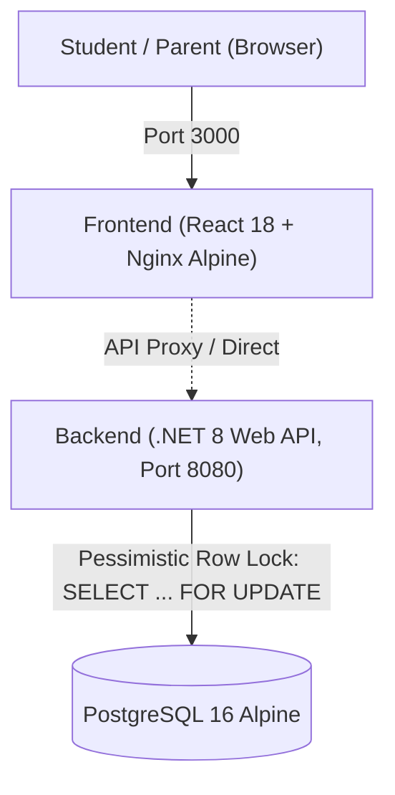

# Smart Admission Pro — Online School Admission System

[](backend/tests/)
[](frontend/src/test/)
[](backend/)
[](docker-compose.yml)
[](frontend/)
[](docker-compose.yml)

> **Recruitment Assessment Submission**  
> **Company:** OnnoRokom Projukti Limited (অন্যরকম প্রযুক্তি লিমিটেড)  
> **Role:** Assistant Software Engineer  

---

## 1. Engineering Approach: Pre-Coding Architecture & Dev-Docs

Before writing application code, the entire system architecture, database schema, locking mechanisms, and 24 user stories were designed in structured development documentation:

* **Proven Professional Methodology:** Adopted from prior full-stack developer experience, where pre-planning eliminated guesswork and ensured clean implementation.
* **Architecture-First:** Database schemas, composite performance indexes, and PostgreSQL pessimistic row locking were designed upfront.
* **Test-Driven Invariants:** Defining mathematical assertions (`held + confirmed <= totalSeats`) before coding guaranteed zero seat overselling from day one.

---

## 2. One-Command Quickstart (Docker Compose)

The multi-tier system (PostgreSQL 16, ASP.NET Core 8 Web API, and React 18 + Nginx) boots with a single command:

```bash
# 1. Clone & enter directory
git clone https://github.com/ranak8811/School-Admission-System.git
cd School-Admission-System

# 2. Build & launch all services
docker compose up -d --build

# 3. Verify container health
docker compose ps
```

* **Zero Local Dependencies:** Requires only Docker. Database migrations and initial catalog seeds apply automatically on startup.

---

## 3. Access Points & Service URLs

| Service | Access URL | Description |
|---|---|---|
| **Frontend Portal** | [http://localhost:3000](http://localhost:3000) | OnnoRokom-branded admission portal (React 18 + Nginx). |
| **Backend API Root** | [http://localhost:8080](http://localhost:8080) | ASP.NET Core 8 Web API. |
| **Swagger / OpenAPI** | [http://localhost:8080/swagger](http://localhost:8080/swagger) | Interactive API exploration and live testing. |
| **Health Check** | [http://localhost:3000/healthz](http://localhost:3000/healthz) | Dual-stack Nginx container healthcheck. |
| **PostgreSQL Database** | `localhost:5432` | User: `postgres`, Password: `postgres`, DB: `school_admission`. |

---

## 4. Architecture & Concurrency Guarantees



* **Zero Overselling Invariant:**  
  For any class `c` at timestamp `t`: `HeldSeats(c, t) + ConfirmedSeats(c, t) <= TotalSeats(c)`.
* **Multi-Instance Concurrency (PRD Section 2.6 Bonus):**  
  Process-level locks fail across distributed replicas. Serialization is enforced at the **PostgreSQL database engine level** via pessimistic row locking (`SELECT * FROM classes WHERE id = @classId FOR UPDATE`). Verified via `MultiInstanceConcurrencyTests.cs` using two simultaneous web hosts firing 100 concurrent requests against a 10-seat class.
* **Dual Expiration Strategy:**  
  * *Dynamic Read CQRS:* All queries evaluate `ExpiresAt > DateTime.UtcNow` in real time, freeing expired seats immediately without waiting for background workers.
  * *Background Sweeper:* `ExpiredHoldSweeper` runs every 30 seconds to update expired records to `EXPIRED` in bulk for database hygiene.

---

## 5. API Reference (All 8 PRD Endpoints)

All endpoints follow REST standards, RFC 7807 `ProblemDetails` error formats, and ISO 8601 UTC timestamps.

| Method | Endpoint | Description | Auth / Headers |
|---|---|---|---|
| `POST` | `/classes` | Create a new class offering | None |
| `GET` | `/classes` | List all offerings with dynamic capacity | None |
| `GET` | `/classes/{id}` | Get capacity for a single class offering | None |
| `POST` | `/classes/{id}/holds` | Reserve a 10-minute seat hold | `X-Student-Id: <17-digit BRN>` |
| `GET` | `/holds/{id}` | Get hold reservation status | None |
| `POST` | `/holds/{id}/confirm` | Confirm admission (Idempotent) | `X-Student-Id: <17-digit BRN>` |
| `DELETE`| `/holds/{id}` | Cancel active hold (frees seat immediately) | `X-Student-Id: <17-digit BRN>` |
| `GET` | `/me/holds` | Get student application history | `X-Student-Id: <17-digit BRN>` |

---

## 6. Automated Testing & Verification Metrics

```
Automated Test Results:
---------------------------------------------------------
Backend Test Suite (xUnit)    : 126 Passed, 0 Failed (788ms)
Frontend Test Suite (Vitest)   :  11 Passed, 0 Failed (1.08s)
Total Automated Test Cases     : 137 Passed (100% Green)
---------------------------------------------------------
```

```bash
# Run backend tests inside Docker:
docker compose exec backend dotnet test

# Run frontend tests:
npm test --prefix frontend -- --run
```

* **113 Unit Tests:** Capacity math, boundary timers (t-1, t, t+1), 17-digit BRN validation, state transitions.
* **9 Contract Tests:** End-to-end HTTP lifecycle across all 8 endpoints and CORS policies.
* **4 Concurrency Tests:** 50 and 100 parallel worker stress tests and multi-instance distributed tests.

---

## 7. Frontend Design & User Experience

* **Institutional Identity:** Built referencing OnnoRokom Projukti Limited (`#0F172A`, `#1E293B`, `#0284C7`), official helpline (16297), and Session 2026–2027 banner.
* **BRN Validation:** 17-digit National digital Birth Registration Number validation with demo ID autofill (`20261110000000001`).
* **Shift-Aware Catalog:** Morning (07:30 AM – 12:00 PM) vs Day (12:30 PM – 05:00 PM) shift filters, occupancy ratios, and fee notes.
* **Printable Voucher:** 1-click printable admission voucher upon confirmation.
* **Silent Polling (4s):** Automatically updates seat capacity every 4 seconds without DOM flicker.

---

## 8. Reports & Project Structure

* **[`ASSUMPTIONS.md`](ASSUMPTIONS.md):** Domain rules, BRN formatting, concurrency proofs, idempotency, and RFC 7807 error standards.
* **[`AI_USAGE.md`](AI_USAGE.md):** Transparent AI disclosure detailing boilerplate assistance and 6 critical concurrency/architectural flaws caught and resolved by the developer.

```
School-Admission-System/
├── ASSUMPTIONS.md                 # Domain & architectural assumptions (PRD Sec 2.7)
├── AI_USAGE.md                    # Transparent AI usage disclosure (PRD Sec 2.7)
├── README.md                      # Primary project documentation
├── docker-compose.yml             # Orchestration: db (PG 16) + backend (.NET 8) + frontend (React/Nginx)
├── backend/
│   ├── Dockerfile                 # Multi-stage .NET 8 build
│   ├── SchoolAdmissionSystem.sln  # Root Visual Studio solution
│   ├── src/SchoolAdmission.Api/   # Web API controllers, services, DbContext, migrations
│   └── tests/SchoolAdmission.Tests/ # 126 unit, integration, and concurrency tests
└── frontend/
    ├── Dockerfile                 # Multi-stage Node 20 -> Nginx Alpine SPA build
    ├── nginx.conf                 # SPA fallback routing (try_files) + dual-stack IPv4/IPv6
    └── src/                       # React 18, Vite, TypeScript, Tailwind components
```
