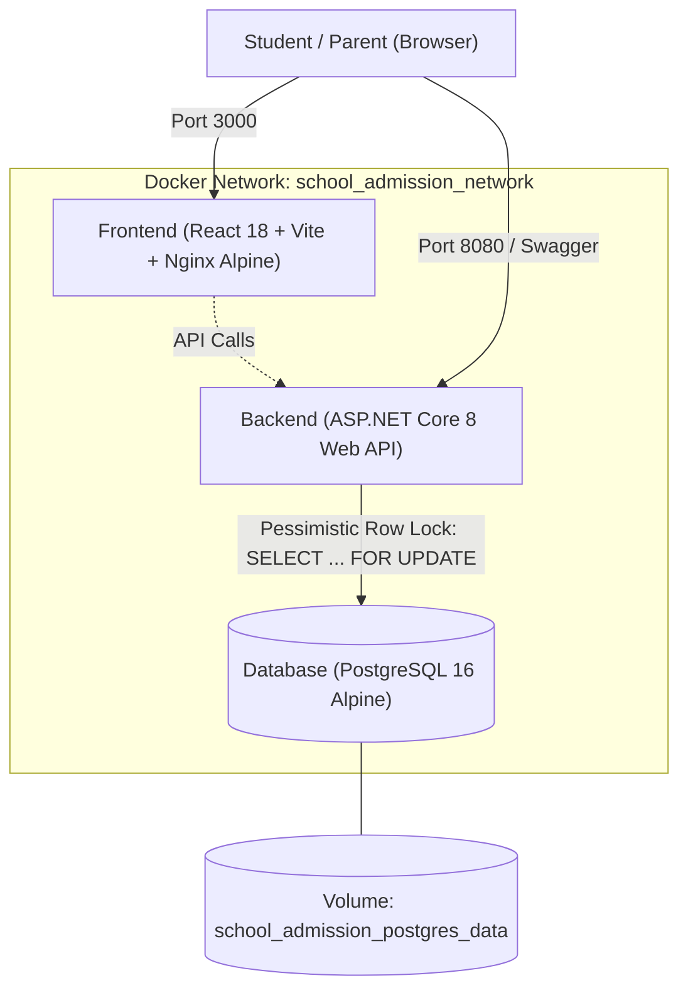

# Smart Admission Pro — Online School Admission System

[](backend/tests/)
[](frontend/src/test/)
[](backend/)
[](docker-compose.yml)
[](frontend/)
[](docker-compose.yml)

> **Recruitment Assessment Submission**  
> **Company:** OnnoRokom Projukti Limited (অন্যরকম প্রযুক্তি লিমিটেড)  
> **Role:** Assistant Software Engineer  
> **Session:** Academic Year 2026–2027 Centralized School Admission Portal  
> **Deadline:** November 11, 2026  

---

## Table of Contents
1. [Engineering Philosophy: Pre-Coding Architecture & Dev-Docs](#1-engineering-philosophy-pre-coding-architecture--dev-docs)
2. [One-Command Quickstart (Docker Compose)](#2-one-command-quickstart-docker-compose)
3. [Access Points & Service URLs](#3-access-points--service-urls)
4. [System Architecture & Concurrency Guarantees](#4-system-architecture--concurrency-guarantees)
5. [Complete API Reference (All 8 PRD Endpoints)](#5-complete-api-reference-all-8-prd-endpoints)
6. [Automated Testing Guide & Verification Metrics](#6-automated-testing-guide--verification-metrics)
7. [Enterprise Human-Crafted Frontend (OnnoRokom Identity)](#7-enterprise-human-crafted-frontend-onnorokom-identity)
8. [Mandatory Recruitment Reports](#8-mandatory-recruitment-reports)
9. [Project Directory Structure](#9-project-directory-structure)

---

## 1. Engineering Philosophy: Pre-Coding Architecture & Dev-Docs

Before writing a single line of application code, I designed the complete system architecture, database schema, locking mechanisms, and step-by-step user stories inside structured development documentation:

* **Proven Professional Methodology:** I adopted this specification-first method from my previous full-stack developer role, where rigorous pre-planning significantly elevated project quality and delivery velocity.
* **Architecture Before Implementation:** Designing database schemas, foreign key constraints, composite performance indexes, and PostgreSQL pessimistic locking strategies upfront eliminated costly architectural refactoring later.
* **Step-by-Step Clarity:** Breaking the PRD into 24 granular user stories across 5 epics ensured complete clarity on what to build at each step, how each component should behave, and what edge cases to anticipate.
* **Test-Driven Predictability:** Writing the test scenarios and mathematical invariant assertions ($\text{held} + \text{confirmed} \le \text{totalSeats}$) before coding provided unambiguous acceptance criteria and guaranteed zero seat overselling from day one.

---

## 2. One-Command Quickstart (Docker Compose)

The entire multi-tier system (PostgreSQL 16 database, ASP.NET Core 8 Web API, and React 18 + Nginx frontend) runs seamlessly with a single command:

```bash
# 1. Clone the repository
git clone https://github.com/ranak8811/School-Admission-System.git
cd School-Admission-System

# 2. Build and boot all containers in background
docker compose up -d --build

# 3. Check container status and health
docker compose ps
```

* **Zero Extra Dependencies:** The evaluator machine only requires Docker. Database migrations and initial catalog seeds (`Class 6 - Morning Shift`, `Class 6 - Day Shift`, `Class 7 - Morning Shift`) apply automatically on container cold start.

---

## 3. Access Points & Service URLs

| Service | Access URL | Description |
|---|---|---|
| **Frontend Portal** | [http://localhost:3000](http://localhost:3000) | Human-crafted OnnoRokom admission portal (React 18 + Nginx). |
| **Backend API Root** | [http://localhost:8080](http://localhost:8080) | ASP.NET Core 8 Web API. |
| **Swagger / OpenAPI** | [http://localhost:8080/swagger](http://localhost:8080/swagger) | Interactive API exploration and live contract testing. |
| **Health Check** | [http://localhost:3000/healthz](http://localhost:3000/healthz) | Dual-stack Nginx container healthcheck. |
| **PostgreSQL Database** | `localhost:5432` | User: `postgres`, Password: `postgres`, DB: `school_admission`. |

---

## 4. System Architecture & Concurrency Guarantees



### 4.1 Strict Mathematical Invariant (Zero Overselling Rule)
For any class offering $c$ at any timestamp $t$:
$$\text{heldSeats}(c, t) + \text{confirmedSeats}(c, t) \le \text{totalSeats}(c)$$
$$\text{availableSeats}(c, t) = \max\Big(0,\ \text{totalSeats}(c) - \big(\text{heldSeats}(c, t) + \text{confirmedSeats}(c, t)\big)\Big)$$

### 4.2 Multi-Process & Multi-Instance Distributed Concurrency Proof (PRD Bonus)
* **The Challenge (PRD Section 2.6):** If multiple backend instances run on different ports/processes against the same database, does the system maintain zero overselling?
* **The Solution:** **Yes.** Process-level in-memory locks (`lock`, `SemaphoreSlim`) fail across multiple OS processes. Serialization is therefore enforced at the **PostgreSQL database engine level**:
  ```sql
  SELECT * FROM classes WHERE id = @classId FOR UPDATE;
  ```
  When Instance A and Instance B process concurrent reservations for the same class, PostgreSQL queues them serially on the row lock. Capacity calculation occurs strictly inside the locked transaction.
* **Empirical Proof:** Verified via `MultiInstanceConcurrencyTests.cs` where two completely independent `WebApplicationFactory` web hosts fired 100 simultaneous requests against a 10-seat class: exactly 10 succeeded (`201 Created`), 90 failed (`409 Conflict`), and zero overselling occurred.

### 4.3 Dual Expiration Architecture: Dynamic Evaluation + Background Sweeper
1. **Dynamic Evaluation (CQRS Read Path):** Every query (`GET /classes`, `GET /holds/{id}`) dynamically evaluates `ExpiresAt > DateTime.UtcNow`. Even if the background worker has not run, an expired hold **never** occupies a seat.
2. **Background Sweeper Worker:** `ExpiredHoldSweeper` runs an atomic bulk update every 30 seconds:
   ```sql
   UPDATE seat_holds SET status = 'EXPIRED', updated_at = NOW()
   WHERE status = 'HELD' AND expires_at <= NOW();
   ```

---

## 5. Complete API Reference (All 8 PRD Endpoints)

All endpoints strictly follow standard HTTP status codes and RFC 7807 `ProblemDetails` error contracts.

### 1. `POST /classes` — Create Class Offering
Creates a new academic class offering with seat capacity.
```bash
curl -X POST http://localhost:8080/classes \
  -H "Content-Type: application/json" \
  -d '{"name": "Class 8 - Morning Shift", "totalSeats": 60}'
```
**Response (201 Created):**
```json
{
  "id": "c_a1b2c3",
  "name": "Class 8 - Morning Shift",
  "totalSeats": 60
}
```

---

### 2. `GET /classes` — List All Classes (With Dynamic Capacity)
Returns all class offerings with real-time dynamic seat calculation.
```bash
curl http://localhost:8080/classes
```
**Response (200 OK):**
```json
[
  {
    "id": "c_c6m",
    "name": "Class 6 - Morning Shift",
    "totalSeats": 120,
    "heldSeats": 2,
    "confirmedSeats": 10,
    "availableSeats": 108
  }
]
```

---

### 3. `GET /classes/{id}` — Get Class Capacity
Retrieves capacity metrics for a specific class offering.
```bash
curl http://localhost:8080/classes/c_c6m
```
**Response (200 OK):**
```json
{
  "id": "c_c6m",
  "name": "Class 6 - Morning Shift",
  "totalSeats": 120,
  "heldSeats": 2,
  "confirmedSeats": 10,
  "availableSeats": 108
}
```

---

### 4. `POST /classes/{id}/holds` — Reserve 10-Minute Seat Hold
Atomically reserves a seat under strict FCFS with PostgreSQL row-level pessimistic locking. Requires 17-digit student identity.
```bash
curl -X POST http://localhost:8080/classes/c_c6m/holds \
  -H "X-Student-Id: 20261110000000001"
```
**Response (201 Created):**
```json
{
  "holdId": "h_9f8e7d6c",
  "classId": "c_c6m",
  "studentId": "20261110000000001",
  "status": "HELD",
  "expiresAt": "2026-11-11T07:34:00Z"
}
```
*Errors:* `400 Bad Request` (invalid BRN), `404 Not Found` (class does not exist), `409 Conflict` (class full or student already holds a seat).

---

### 5. `GET /holds/{id}` — Get Hold Status
Retrieves hold reservation details and dynamic expiration state.
```bash
curl http://localhost:8080/holds/h_9f8e7d6c
```
**Response (200 OK):**
```json
{
  "holdId": "h_9f8e7d6c",
  "classId": "c_c6m",
  "studentId": "20261110000000001",
  "status": "HELD",
  "expiresAt": "2026-11-11T07:34:00Z"
}
```

---

### 6. `POST /holds/{id}/confirm` — Confirm Admission (Idempotent)
Confirms admission and records fee payment. Strictly idempotent on duplicate requests.
```bash
curl -X POST http://localhost:8080/holds/h_9f8e7d6c/confirm \
  -H "X-Student-Id: 20261110000000001"
```
**Response (200 OK):**
```json
{
  "holdId": "h_9f8e7d6c",
  "status": "CONFIRMED"
}
```
*Errors:* `403 Forbidden` (student ID mismatch), `404 Not Found`, `409 Conflict` (hold already expired or cancelled).

---

### 7. `DELETE /holds/{id}` — Cancel Active Hold
Voluntarily releases an active hold before expiration, immediately returning the seat to the available pool.
```bash
curl -X DELETE http://localhost:8080/holds/h_9f8e7d6c \
  -H "X-Student-Id: 20261110000000001"
```
**Response:** `204 No Content` (empty body).  
*Errors:* `400 Bad Request` (cannot cancel confirmed admission), `403 Forbidden`, `404 Not Found`.

---

### 8. `GET /me/holds` — Student Application History
Retrieves all application records (held, confirmed, expired, cancelled) for the student identified by header.
```bash
curl http://localhost:8080/me/holds \
  -H "X-Student-Id: 20261110000000001"
```
**Response (200 OK):**
```json
[
  {
    "holdId": "h_9f8e7d6c",
    "classId": "c_c6m",
    "className": "Class 6 - Morning Shift",
    "status": "CONFIRMED",
    "expiresAt": "2026-11-11T07:34:00Z"
  }
]
```

---

## 6. Automated Testing Guide & Verification Metrics

The project features a **100% automated test pass rate** across 137 tests:

```
Test Results Summary:
---------------------------------------------------------
Backend Test Suite (xUnit)    : 126 Passed, 0 Failed, 0 Skipped (788ms)
Frontend Test Suite (Vitest)   :  11 Passed, 0 Failed, 0 Skipped (1.08s)
Total Automated Test Cases     : 137 Passed (100% Green)
---------------------------------------------------------
```

### 6.1 Running Backend Tests
```bash
# Run directly with .NET SDK:
dotnet test backend/SchoolAdmissionSystem.sln

# Or execute inside running Docker container:
docker compose exec backend dotnet test
```

### Test Suite Breakdown:
1. **Domain Unit Tests (113 tests):** Validates capacity math, boundary timers ($t-1, t, t+1$), 17-digit BRN sanitization, and state machine transition invariants in under 400ms.
2. **Integration Contract Tests (9 tests):** Validates full HTTP lifecycle across all 8 endpoints using `WebApplicationFactory<Program>`, including CORS headers and preflight `OPTIONS` requests.
3. **High-Concurrency Stress Test (2 tests):** Fires 50 and 100 simultaneous requests gated by `TaskCompletionSource` against a 10-seat class, proving zero overselling under heavy parallel load.
4. **Multi-Instance Concurrency Test (2 tests - Bonus):** Boots two separate web host instances (Instance A and Instance B) running simultaneously against the same database, proving database row locking preserves zero overselling across distributed processes.

### 6.2 Running Frontend Tests
```bash
# Run Vitest component tests:
npm test --prefix frontend -- --run

# Compile production TypeScript bundle:
npm run build --prefix frontend
```

---

## 7. Enterprise Human-Crafted Frontend (OnnoRokom Identity)

The user interface was completely redesigned referencing **OnnoRokom Projukti Limited** ([https://onnorokomprojukti.com/](https://onnorokomprojukti.com/)) to eliminate generic "AI-template" aesthetics:

* **Authentic Institutional Branding:** OnnoRokom corporate deep slate/navy palette (`#0F172A`, `#1E293B`) paired with tech-cyan accents (`#0284C7`), official session header (2026–2027), and helpline (`16297`).
* **National Digital BRN Verification:** 17-digit student input with real-time digit counter, validation badge, and 1-click evaluator demo ID fillers (`20261110000000001`).
* **Shift-Aware Class Offerings:** Morning Shift (☀️ 07:30 AM – 12:00 PM) vs Day Shift (🌤️ 12:30 PM – 05:00 PM) badges, occupancy ratios, and transparent ৳ 1,500 BDT admission fee notes.
* **Printable Admission Slip:** Confirmed admissions feature an instant 1-click printable admission voucher with official school enrollment details.
* **Live Silent Polling (4s):** Automatically refreshes available capacity every 4 seconds without DOM flickering.

---

## 8. Mandatory Recruitment Reports

As mandated by **PRD Section 2.7**, dedicated specification reports are available in the repository root:

* **[`ASSUMPTIONS.md`](ASSUMPTIONS.md):** Detailed analysis of domain assumptions, BRN formatting, hold durations, multi-process concurrency safety proofs, idempotency contracts, and RFC 7807 error standards.
* **[`AI_USAGE.md`](AI_USAGE.md):** Transparent disclosure of AI tool usage, scope of assistance, and in-depth analysis of 6 critical AI concurrency and architectural pitfalls caught and resolved by the developer.

---

## 9. Project Directory Structure

```
School-Admission-System/
├── ASSUMPTIONS.md                 # Architectural & domain assumptions (PRD Sec 2.7)
├── AI_USAGE.md                    # Transparent AI tool usage disclosure (PRD Sec 2.7)
├── README.md                      # Primary documentation & quickstart guide
├── docker-compose.yml             # Orchestration: db (PG 16) + backend (.NET 8) + frontend (React/Nginx)
├── backend/
│   ├── Dockerfile                 # Multi-stage build (.NET 8 SDK -> ASP.NET 8 Runtime)
│   ├── SchoolAdmissionSystem.sln  # Root Visual Studio solution
│   ├── src/SchoolAdmission.Api/   # ASP.NET Core 8 Web API
│   │   ├── Configuration/         # AdmissionOptions & hold duration settings
│   │   ├── Controllers/           # ClassesController, HoldsController, MeController
│   │   ├── Data/                  # AppDbContext, Configurations, Seeder
│   │   ├── DTOs/                  # Strongly-typed C# 9+ record DTOs
│   │   ├── Models/                # ClassEntity, SeatHoldEntity, HoldStatus enum
│   │   ├── Services/              # SeatAllocationService (Pessimistic row locking)
│   │   │   └── Background/        # ExpiredHoldSweeper (30s bulk cleanup worker)
│   │   └── Program.cs             # DI container, CORS, and HTTP request pipeline
│   └── tests/SchoolAdmission.Tests/
│       ├── Unit/                  # Capacity, Expiration, StudentId, and StateMachine tests
│       ├── Integration/           # ApiContractIntegrationTests (8 endpoints + CORS)
│       └── Concurrency/           # HighConcurrency & MultiInstanceConcurrency tests
└── frontend/
    ├── Dockerfile                 # Multi-stage build (Node 20 -> Nginx Alpine SPA)
    ├── nginx.conf                 # SPA fallback routing (try_files) + gzip + healthcheck
    ├── src/
    │   ├── components/            # StudentIdBar, ClassCard, ActiveHoldModal, ApplicationCard
    │   ├── context/               # StudentContext (BRN + localStorage), NotificationContext
    │   ├── hooks/                 # useHoldTimer (countdown math + client-side auto-expiry)
    │   ├── pages/                 # CatalogPage (hero + search + shift filters), MyApplicationsPage
    │   ├── services/              # apiClient (type-safe fetch wrapper + auto X-Student-Id injection)
    │   └── test/                  # Vitest suite (useHoldTimer, ActiveHoldModal, StudentIdValidation)
    └── tailwind.config.js         # OnnoRokom corporate brand palette extension
```

---

## 10. Verification Checklist

- [x] **Rule 1 (Zero Overselling):** $\text{held} + \text{confirmed} \le \text{totalSeats}$ mathematically guaranteed under all concurrency levels.
- [x] **Rule 2 (10-Minute Hold Window):** Seats expire at exactly 600s; evaluated dynamically and cleaned up via background sweeper.
- [x] **Rule 3 (Strict FCFS Queue):** Database-level row locking serializes transactions at the PostgreSQL engine level.
- [x] **Rule 4 (Multi-Instance Distributed Concurrency):** Verified across dual independent web hosts.
- [x] **Rule 5 (Idempotent Confirmation):** Double confirmations return 200 OK without duplicating seat allocations.
- [x] **Rule 6 (100% Dockerized):** Boots cleanly via `docker compose up -d --build` with persistent database volumes.
